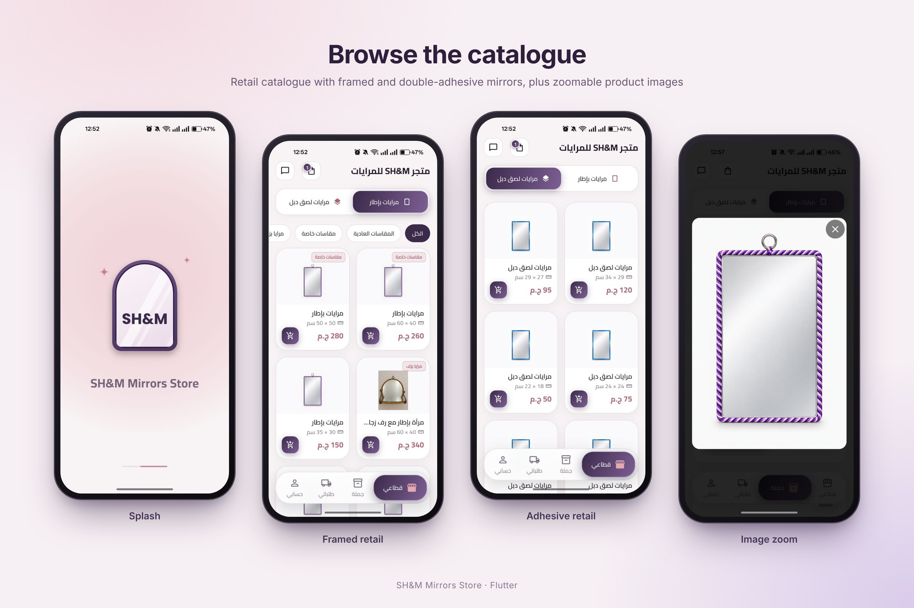
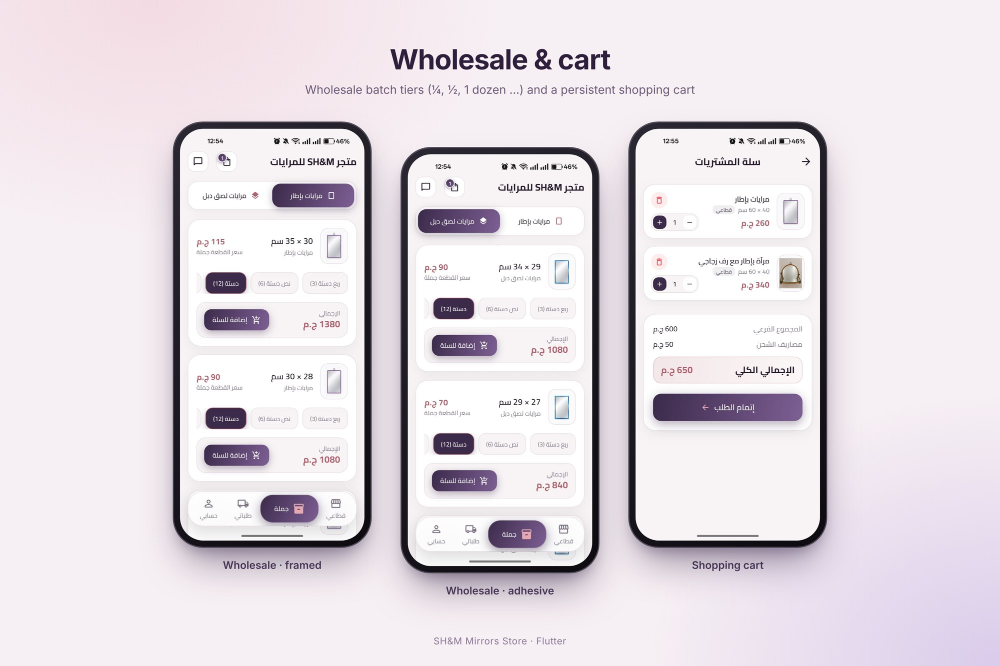
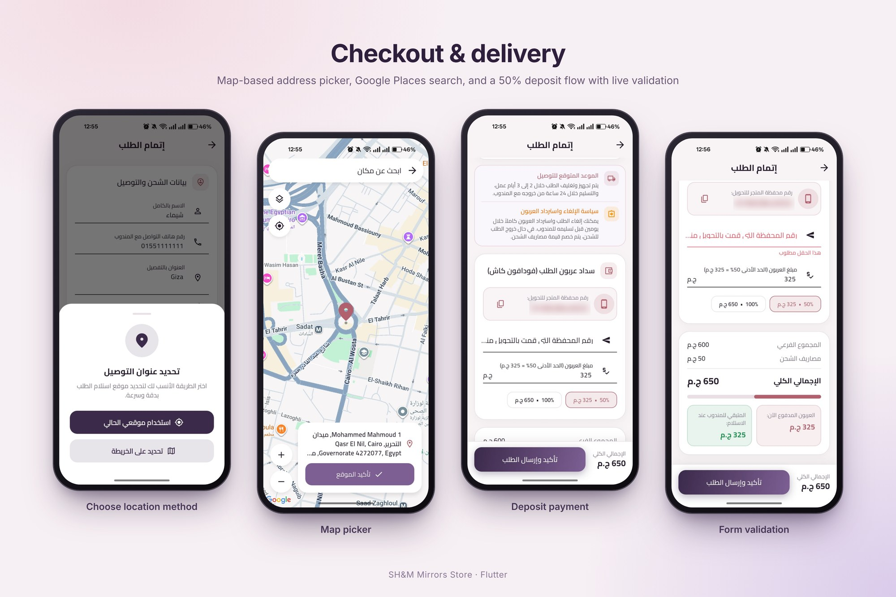
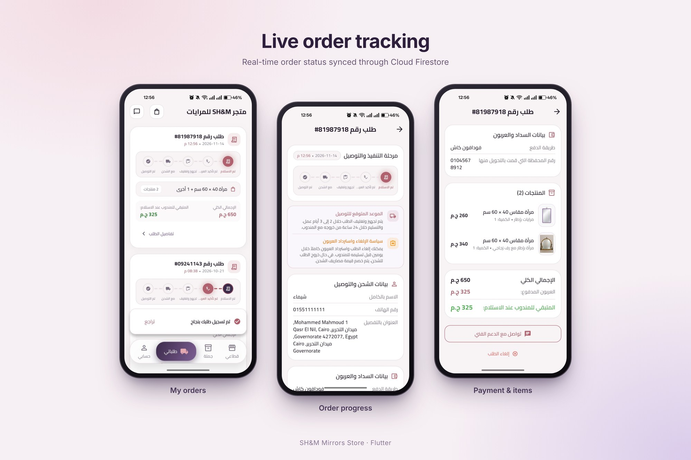
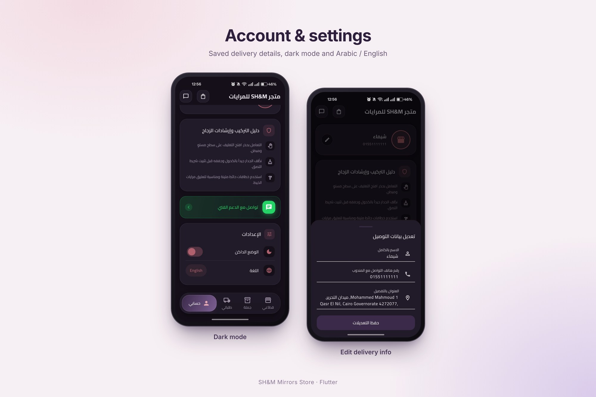

# 🪞 SH&M Mirrors Store

A bilingual (Arabic / English) **retail + wholesale ordering app** for a mirror manufacturer, built with **Flutter**, **Bloc (Cubit)** and **Firebase Cloud Firestore**. Customers browse the catalogue, preview a mirror on their own wall through the camera, place an order with a deposit, and follow it live until delivery.

It is the customer-facing half of a two-app system. Orders are processed by the companion **[Mirrors Admin](../mirrors-admin-app)** app through the same Firestore backend.

## 📸 App Showcase

### Browse the catalogue


### Wholesale & cart


### Checkout & delivery


### Live order tracking


### Account & settings


---

## ✨ Features

### 🛍️ Catalogue: retail and wholesale
- Two product categories: **Framed** and **Double-adhesive** mirrors.
- **Retail view** with sub-filters: standard sizes, **special sizes** and **mirrors with shelf** (retail-only products).
- **Wholesale view** with batch pricing: customers pick a **tier** (¼ dozen = 3, ½ dozen = 6, 1 dozen, 1½ dozen, 2 dozen) and the cart adds and removes stock in wholesale steps with a minimum quantity.
- Zoomable product images.

### 📷 Wall preview (camera overlay)
- Opens the rear camera and places the selected mirror on top of the live feed.
- **Drag and pinch-to-scale** the mirror to see how it will look on the wall before buying, with permission handling and a fallback when the camera is unavailable.

### 🛒 Cart & checkout
- Cart is **persisted locally**, so it survives app restarts.
- Checkout with shipping details and a **delivery-timeline notice**.
- **Deposit flow**: customers pay at least **50 %** of the order total by mobile wallet and enter their sender wallet number. The minimum is rounded up to a whole pound so validation never rejects a legitimate amount, and the remaining balance is calculated live.
- Egyptian phone-number validation.

### 📍 Delivery address with map picker
- Interactive **map location picker** with a centre pin.
- **Place autocomplete** (Google Places API *New*) with session tokens to group requests into one billed session, biased toward the area the user is viewing and restricted to Egypt.
- **Reverse geocoding** and device-location support to fill the address automatically.

### 📦 Live order tracking
- Orders are written to **Firestore** and streamed back in real time.
- Visual **progress stepper**: Received → Deposit confirmed → Preparing → Shipping → Delivered (or Cancelled).
- Order details screen with items, totals, payment and shipping cards, and a cancel action.
- Orders are cached locally and shown instantly while the stream connects.
- No sign-up needed: each device gets a **guest ID**, and orders are linked to it.

### 🌍 Experience
- Arabic / English with RTL support, light / dark themes, persisted settings.
- WhatsApp support shortcut and a **glass-safety guide**.
- Animated splash screen.

---

## 🛠️ Tech Stack

| Area | Choice |
|---|---|
| Framework | Flutter |
| State management | **flutter_bloc** (Cubits: `CartCubit`, `OrdersCubit`, `AppSettingsCubit`) |
| Navigation | **go_router** |
| Backend | **Firebase Cloud Firestore** (real-time streams) |
| Maps & places | Google Places API (New), `geolocator`, `geocoding` |
| Camera | `camera`, `permission_handler` |
| Localisation | Flutter `gen-l10n` (`.arb`, Arabic + English) |
| Config | `flutter_dotenv` |
| Persistence | `shared_preferences` |

---

## 🏗️ Architecture

```
lib/
├── core/            # Routing, theme, colours, validators, shared widgets, config
├── data/
│   ├── models/      # MirrorUiModel, CartItemModel, OrderUiModel (JSON-serialisable)
│   └── services/    # Firestore orders, Google Places, reverse geocoding, device location
├── l10n/            # ARB files + generated localisations (ar / en)
└── presentation/
    ├── manager/     # Cubits + states: cart, orders, app settings
    ├── screens/     # Retail, wholesale, cart, checkout, orders, details, wall preview, profile
    └── widgets/     # Small, focused widgets grouped by screen (catalog, checkout, orders …)
```

**Design decisions**
- **Cubits own state, services own I/O.** UI widgets never touch Firestore or HTTP directly.
- **Offline-tolerant orders:** an order is saved locally first and then synced to Firestore, and the live stream keeps the local copy up to date.
- **UI split into small widgets** per screen (e.g. checkout is composed of shipping, deposit, summary and submit sections) to keep files short and reusable.

---

## 🚀 Getting Started

**Prerequisites:** Flutter SDK, a Firebase project (Firestore enabled) and a Google Cloud project with the Places API (New) enabled.

```bash
git clone https://github.com/shimaakhaled1410-hue/mirrors-store-app.git
cd mirrors-store-app
flutter pub get
```

**Configuration**
1. Create `assets/.env` with your own values:
   ```
   WALLET_PHONE_NUMBER=<store wallet number>
   WHATSAPP_SUPPORT_PHONE=<support number>
   ```
2. Connect your own Firebase project (`flutterfire configure`).
3. Provide your own Google Places API key.

```bash
flutter run
```

---

## 👩‍💻 Author

**Shimaa Khaled**, Flutter Developer
[GitHub](https://github.com/shimaakhaled1410-hue)